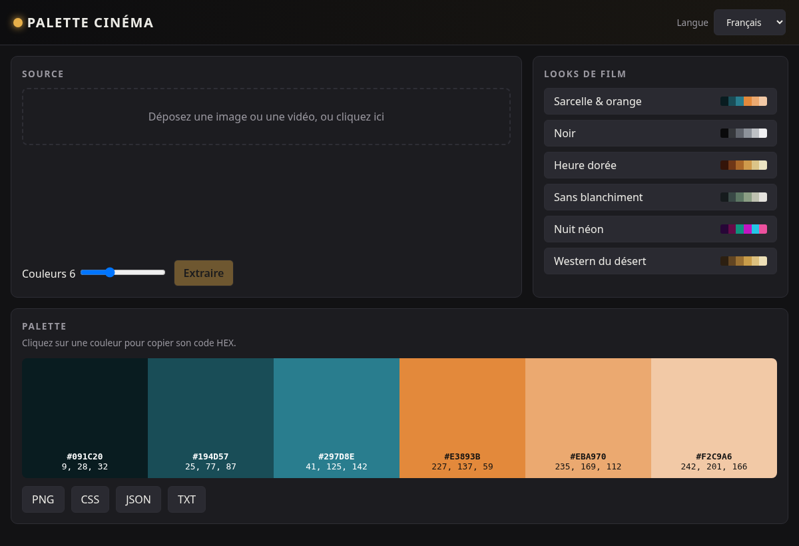

# Palette Cinéma 🎬

Free, open-source, single-page browser tool that extracts a **cinematic color palette** (k-means, 5–8 colors) from an image or a video frame. Runs 100% in your browser — no install, no account, no upload to any server.

**Demo:** https://salimadour31-boop.github.io/palette-cinema/



## Features
- Upload / drag-and-drop an image, or a video and capture any frame (`<video>` + canvas)
- k-means++ color extraction (5–8 colors), sorted dark → light
- HEX + RGB display, click a swatch to copy its HEX
- Export: PNG, CSS variables, JSON, plain text
- Original film-look presets: Teal & orange, Noir, Golden hour, Bleach bypass, Neon night, Desert western
- Languages: Français, English, Taqbaylit
- Responsive, system fonts only, no dependencies

## Usage
Open the demo, or clone and open `index.html` in any modern browser.

```
git clone https://github.com/salimadour31-boop/palette-cinema.git
node palette-cinema/test/palette.test.js   # run logic tests
```

## License
MIT — see [LICENSE](LICENSE).
